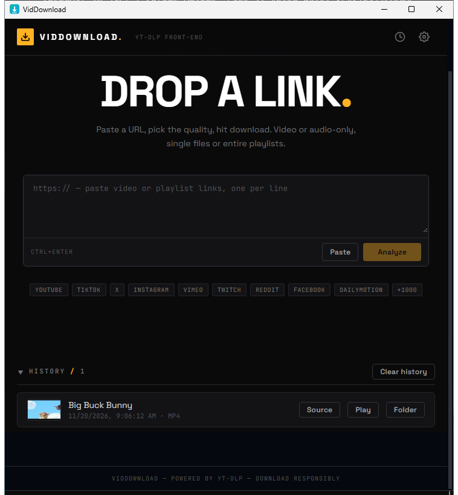
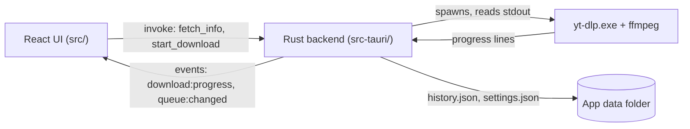

<div align="center">

# VidDownload.

**A tiny, fast desktop downloader for video and audio from 1000+ sites.**
Paste a link, pick the quality, hit download.

[](https://github.com/avixkap/vid-download/actions/workflows/ci.yml)
[](LICENSE)




</div>

## Features

- **1000+ sites** (YouTube, TikTok, X, Instagram, Vimeo, Twitch, Reddit and more), powered by [yt-dlp](https://github.com/yt-dlp/yt-dlp)
- **Video or audio-only**: pick the quality (up to 4K) and container (MP4 / MKV / WebM), or extract MP3 / M4A / Opus
- **Playlists**: preview the entries and download a whole playlist in one click
- **Subtitles**: download and embed them, with a language filter
- **Download queue**: parallel downloads with pause, resume, retry and cancel
- **Live progress**: percent, speed and ETA, plus a notification when each download finishes
- **History**: replay a file, open its folder or revisit the source page
- **Scheduler**: queue a download to start at a set time
- **Login-required sites**: read cookies from your browser or a `cookies.txt` file
- **Small**: about a 1.8 MB installer, because it uses the system WebView2 instead of bundling a browser

## Install

1. Download `VidDownload_x.y.z_x64-setup.exe` from the [Releases](https://github.com/avixkap/vid-download/releases) page.
2. Run the installer. No admin rights are needed; it installs per-user.
3. On first launch, click **Install components**. The app downloads `yt-dlp` and `ffmpeg` (about 85 MB, one time only).

**Requirements:** Windows 10 or 11 with the [Microsoft Edge WebView2 runtime](https://developer.microsoft.com/microsoft-edge/webview2/). WebView2 comes preinstalled on Windows 11 and most up-to-date Windows 10 machines.

## How it works

VidDownload is a [Tauri 2](https://tauri.app) app. The window is a React UI; a small Rust backend runs `yt-dlp` and reports progress back to it.



App data (components, settings, history) lives in `%APPDATA%\com.viddownload.app`. Downloads go to `Downloads\VidDownload` by default; you can change this in Settings.

## Build from source

**Prerequisites**

- [Node.js](https://nodejs.org) 20 or newer
- [Rust](https://rustup.rs) (stable)
- [Microsoft C++ Build Tools](https://visualstudio.microsoft.com/visual-cpp-build-tools/) with the "Desktop development with C++" workload

See the [Tauri prerequisites guide](https://tauri.app/start/prerequisites/) for details.

**Commands**

```bash
git clone https://github.com/avixkap/vid-download.git
cd vid-download
npm install

npm run dev      # run the app with hot reload
npm run dist     # build the release exe + NSIS installer

cd src-tauri && cargo test   # run the Rust unit tests
```

The installer is written to `src-tauri/target/release/bundle/nsis/`.

## Project structure

```text
src/                     React + TypeScript frontend
  components/            UI components (Hero, AnalyzeCard, DownloadsSection, ...)
  api.ts                 typed bridge to the Rust commands and events
  store.ts               UI state (zustand)
src-tauri/               Rust backend
  src/lib.rs             app setup + the commands the UI can call
  src/queue.rs           download queue, pause/resume/cancel
  src/ytdlp.rs           builds yt-dlp arguments, spawns the process
  src/parser.rs          parses yt-dlp progress output (unit tested)
  src/binaries.rs        first-run download of yt-dlp and ffmpeg
  src/store.rs           settings, history and schedule persistence
  src/scheduler.rs       starts scheduled downloads
  capabilities/          permissions granted to the UI
  tauri.conf.json        window, bundle and installer config
scripts/                 dev helpers (icon generator, end-to-end test driver)
```

## Troubleshooting

**Windows Defender or SmartScreen flags the installer.**
Release builds are not code-signed yet, so some antivirus heuristics report false positives (for example `Wacatac!ml`). If you built it yourself or downloaded it from this repo's Releases page, you can allow it in Windows Security. Signed builds are planned.

**"Sign in to confirm you're not a bot" or a login error.**
Open **Settings**, then under **Cookies** choose the browser you're signed in with, or select a `cookies.txt` file. Close that browser completely while downloading, because Chromium-based browsers lock their cookie store.

**A site stopped working.**
Sites change often and yt-dlp updates to keep up. In **Settings**, click **Re-check / update**. If that doesn't help, delete the `bin` folder inside `%APPDATA%\com.viddownload.app` and restart; the newest yt-dlp will be downloaded.

## Disclaimer

VidDownload is a front-end for yt-dlp. Only download content you own or have permission to download, and respect each site's terms of service and your local copyright law. The authors are not responsible for how the software is used.

## Contributing

Bug reports, ideas and pull requests are welcome. Please read [CONTRIBUTING.md](CONTRIBUTING.md) first. To report a security issue, see [SECURITY.md](SECURITY.md).

## License

[MIT](LICENSE) © 2026 avixkap

## Credits

- [yt-dlp](https://github.com/yt-dlp/yt-dlp): the download engine
- [FFmpeg](https://ffmpeg.org), using [gyan.dev](https://www.gyan.dev/ffmpeg/builds/) Windows builds: merging, converting and audio extraction
- [Tauri](https://tauri.app), [React](https://react.dev), [Tailwind CSS](https://tailwindcss.com)
- Fonts: [Space Grotesk](https://github.com/floriankarsten/space-grotesk) and [JetBrains Mono](https://www.jetbrains.com/lp/mono/)
